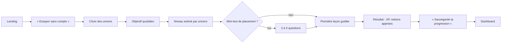
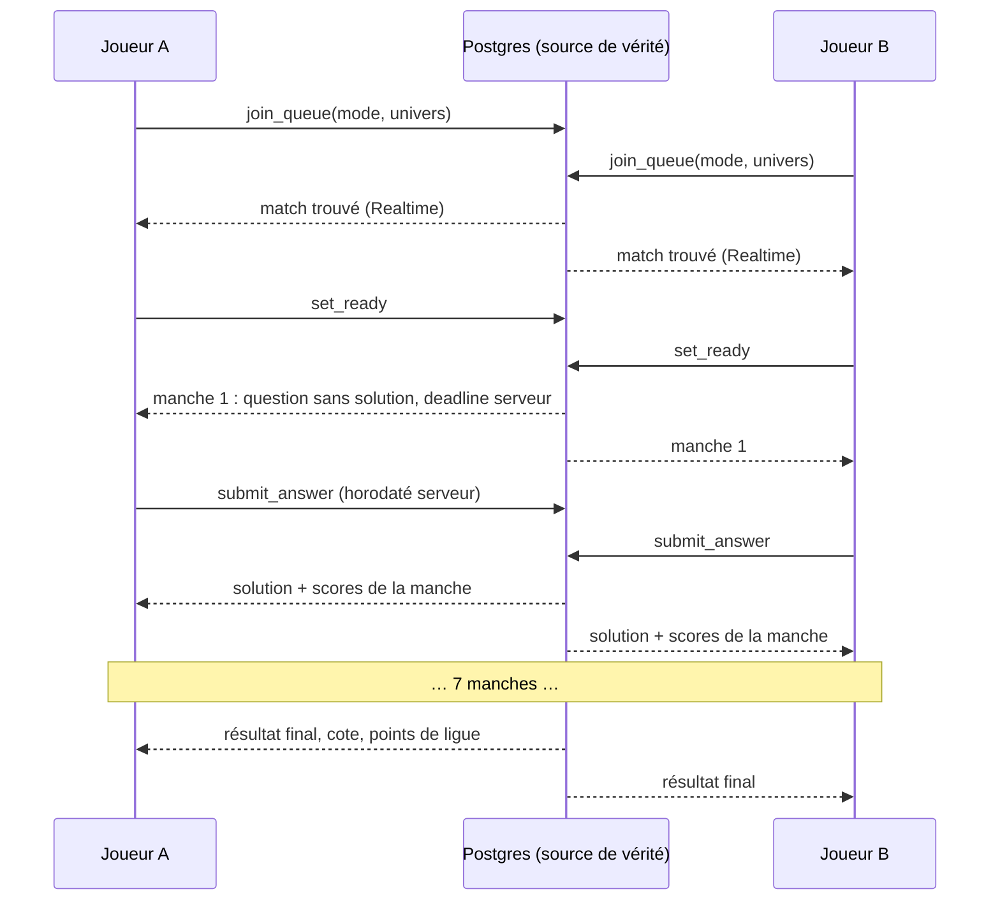
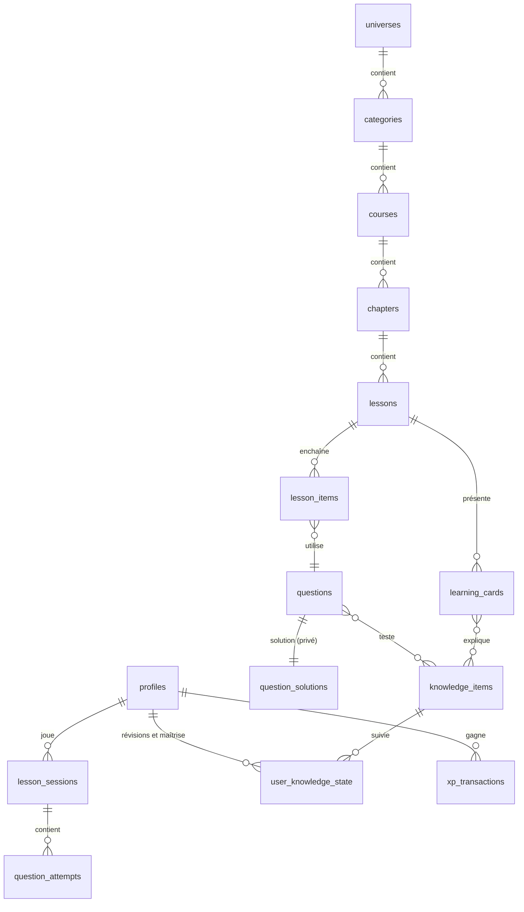

# Phase 0 — Brief de cadrage

> Statut : **proposition, en attente de validation**. Rien n'est développé tant que les décisions de la section 10 ne sont pas tranchées.
> Date : 26 novembre 2026. Nom de code provisoire : **« Kulto »** (remplaçable en une ligne dans `src/config/brand.ts` dès la phase 1).

Sommaire :

1. Compréhension du concept
2. Améliorations produit proposées
3. Dix propositions de naming
4. Trois directions artistiques
5. Expérience utilisateur principale
6. Architecture technique recommandée
7. Schéma de données initial
8. Stratégie de développement par phases
9. Services à préparer
10. Décisions à prendre ensemble

---

## 1. Compréhension du concept

### La promesse

> **Développe ta culture. Explore tes passions. Défie tes amis.**

Une plateforme qui transforme le temps que les 16-25 ans passent déjà sur leurs passions (F1, rap, R&B, jeux vidéo, cinéma…) en **connaissances actives, mesurables et partageables**.

Aujourd'hui, cette culture se construit de façon passive et dispersée : vidéos YouTube, threads Reddit, TikTok, Wikipedia à 2 h du matin. Personne ne peut dire « je connais vraiment la F1 » avec une preuve. Le produit apporte trois choses que ces sources n'ont pas :

| Besoin | Ce que le produit apporte | Mécanique |
|---|---|---|
| Apprendre sans effort scolaire | Des parcours courts et structurés, du plus simple au plus pointu | Univers → Parcours → Chapitres → Leçons, fiches + mini-jeux |
| Retenir | La connaissance revient au bon moment | Répétition espacée sur des « notions » |
| Exister | Une identité culturelle et un statut | ADN culturel, titres, badges, divisions, duels |

### Trois boucles imbriquées

1. **Boucle quotidienne (3 à 10 min)** : Daily Challenge + une leçon + quelques révisions. C'est l'habitude.
2. **Boucle de progression (semaines)** : parcours, chapitres, boss, niveaux par univers, maîtrise. C'est la profondeur.
3. **Boucle sociale et compétitive (saison)** : ligues hebdomadaires, duels, amis, partage. C'est le statut.

### Ce que j'en retiens

- **Le vrai concurrent n'est pas Duolingo**, c'est le scroll. Une session doit tenir dans le temps d'un trajet de métro et procurer une satisfaction immédiate.
- **La profondeur est le différenciateur.** Les apps de quiz existent ; un parcours qui t'emmène de « c'est quoi un undercut ? » à « pourquoi l'undercut fonctionne moins bien à Monaco » n'existe pas.
- **Le principal risque est le contenu, pas le code.** 15 formats de jeux × 9 univers, avec des faits vérifiés, datés et sourcés, c'est le goulot d'étranglement. L'architecture doit rendre la production de contenu rapide et fiable dès le début.

---

## 2. Améliorations produit proposées

Je challenge certains points du cahier des charges. Chaque proposition est argumentée ; les plus structurantes sont reprises dans les décisions de la section 10.

### 2.1 Séparer la « notion » de la « question » ⭐ (structurant)

Le cahier prévoit des questions et des fiches. Je propose d'ajouter une unité intermédiaire : la **notion** (`knowledge_items`), un fait ou un concept atomique.

- *Notion* : « L'undercut consiste à s'arrêter avant son rival pour profiter de pneus neufs. »
- Elle est **présentée** par une fiche et **testée** par plusieurs questions de formats différents (quiz, vrai/faux, match…).

Bénéfices :

- La **répétition espacée** porte sur la notion, pas sur la question : en révision, on reteste la même connaissance avec un autre format. L'utilisateur ne peut pas mémoriser « la réponse B ».
- La **maîtrise** devient calculable proprement : notions → leçon → chapitre → catégorie → univers. On distingue enfin « beaucoup d'XP » et « vraie maîtrise ».
- Les **faits évolutifs** (palmarès, records) se mettent à jour à un seul endroit, et toutes les questions liées sont signalées.

### 2.2 Réduire le périmètre de lancement, approfondir

- **5 formats en V1** : Quiz, Vrai/Faux, Match, Timeline, Guess The Year. Ils couvrent 80 % des besoins pédagogiques et ne posent aucun problème de droits.
- **Phase suivante** : Who Am I, Higher or Lower, Odd One Out, Connections, Speedrun, Survival, Boss Battle.
- **Reportés pour raisons de droits** : Pixel Reveal (photos de pilotes, pochettes), Blind Test (extraits musicaux). Spotify a retiré l'accès aux extraits audio pour les nouvelles applications en 2024 ; les autres API ont des conditions restrictives pour un usage en jeu. Je propose des alternatives : Pixel Reveal avec des illustrations originales (silhouettes de circuits, monoplaces dessinées) ou des images Wikimedia Commons sous licence compatible et correctement attribuées.
- **Un parcours profond par univers** plutôt que plusieurs parcours superficiels.

### 2.3 Résoudre le « démarrage à froid » du multijoueur ⭐ (structurant)

Avec peu d'utilisateurs, une file de matchmaking en temps réel reste vide, et un joueur qui attend 2 minutes sans adversaire ne revient pas.

Proposition :

- **Duels asynchrones dès la phase 4** (et pas « à terme ») : tu joues ta manche, ton adversaire joue la sienne quand il veut (avec les mêmes questions), puis le résultat tombe.
- **Matchmaking temps réel** quand la file contient des joueurs ; au-delà de ~20 s d'attente, on propose de basculer en asynchrone.
- **Jamais de bot présenté comme un humain.** Si on ajoute un jour un adversaire simulé, il sera explicitement étiqueté.

### 2.4 Clarifier les deux systèmes compétitifs ⭐ (structurant)

Le cahier mélange deux mécaniques qui peuvent se contredire : un rang façon Rocket League (basé sur le niveau) et des ligues hebdomadaires façon Duolingo (basées sur l'activité). Ma proposition :

| Système | Visible ? | Rôle | Calcul |
|---|---|---|---|
| **Cote (MMR)** | Non | Matchmaking équitable | Elo à K dynamique en V1 (évolution possible vers Glicko-2) |
| **Division** (Bronze → Légende) | Oui | Statut, identité | Évolue chaque semaine via la ligue (promotion/relégation) |
| **Points de championnat** | Oui | Classement de la semaine | Duels classés + Daily Challenge, **plafonnés** |

Contre l'avantage du temps libre : **seuls les 15 meilleurs duels classés de la semaine comptent**, et le Daily Challenge rapporte au maximum une fois par jour. Un joueur qui fait 15 bons duels bat un joueur qui en fait 80 médiocres. Tous les seuils sont configurables.

### 2.5 Faire du Daily Challenge le moteur d'acquisition

- **Jouable sans compte**, identique pour tous, résultat partageable sans spoiler (grille de cases + score + lien).
- C'est la boucle virale : je partage → un ami clique → il joue sans friction → on lui propose de sauvegarder sa progression.

### 2.6 Mode invité réel, sans localStorage ⭐

Supabase Auth propose les **connexions anonymes** : l'invité a un vrai compte côté serveur (progression, XP, Daily Challenge persistés en base), qu'il convertit ensuite en compte email sans rien perdre.

- Respecte la règle « pas de localStorage pour simuler le backend ».
- À protéger par CAPTCHA (Cloudflare Turnstile, gratuit) et par une purge automatique des comptes anonymes inactifs (ex. 30 jours).

### 2.7 Inverser l'onboarding : la valeur avant le formulaire

Le cahier place la création de compte (étape 6) avant la première activité (étape 7). Je propose de **faire jouer d'abord** : univers → objectif → niveau → première leçon guidée (en invité) → écran de résultat → « Sauvegarde ta progression » → création de compte. On demande l'email une fois que l'utilisateur a quelque chose à perdre.

### 2.8 Une série (streak) bienveillante

- **Protection de série** gagnée en jouant (1 par semaine de série, 2 en stock maximum), consommée automatiquement.
- **Réparation** possible dans les 24 h en doublant l'objectif du jour.
- **Ton jamais culpabilisant** : « Ta série a fait une pause. On repart ? » plutôt que « Tu as perdu ta série ».
- Journée calculée selon le fuseau horaire de l'utilisateur.

### 2.9 Contenu « as code » en V1 ⭐

Avant d'avoir une interface d'administration, le contenu vit dans le repo sous forme de fichiers JSON (`content/`), validés par des schémas Zod, importés par un script.

- Versionné et relu via pull request sur GitHub (traçabilité, relecture des faits).
- Validation automatique en CI : un fait évolutif sans date de vérification, une question sans explication ou une timeline sans dates bloquent l'import.
- L'interface d'admin (phase 6) écrit ensuite dans les mêmes tables, avec les mêmes validations.

### 2.10 Protection des mineurs dès la V1

- **Avatars choisis dans une bibliothèque originale**, pas d'upload d'image en V1 (zéro modération d'images).
- Pseudonymes filtrés (liste de termes interdits + signalement).
- Aucune messagerie libre ; réactions prédéfinies en duel.
- **Âge minimum 15 ans** à l'inscription (âge de consentement numérique en France), via une simple case à cocher ou l'année de naissance, sans collecter la date complète.

### 2.11 Navigation : 6 niveaux de données, 3 niveaux d'écrans

La hiérarchie Univers → Catégorie → Parcours → Chapitre → Leçon → Activités est juste côté données, mais 6 écrans successifs seraient pénibles. Côté interface :

1. **Page univers** (les catégories sont des onglets ou des filtres, pas un écran).
2. **Page parcours** : un chemin visuel de chapitres et de leçons.
3. **Lecteur de leçon** en plein écran.

### 2.12 Faits évolutifs datés

Toute statistique susceptible de changer porte une date (« au 30 novembre 2026 ») et une date de vérification. Une file « contenu à revérifier » remonte les faits anciens dans l'admin.

---

## 3. Dix propositions de naming

Critères : court, mémorisable, prononçable en français et en anglais, évocateur (curiosité, progression, connaissance ou jeu), capable de porter une identité forte.

> ⚠️ **Aucune disponibilité n'a été vérifiée** (marques, domaines, réseaux sociaux, stores). Les risques indiqués viennent de mes connaissances générales. Avant tout choix définitif : recherche INPI, EUIPO et WIPO Global Brand Database en classes 9 (logiciels), 41 (éducation, divertissement) et 28 (jeux), puis domaines `.com`, `.app`, `.fr` et handles.

| # | Nom | Territoire | Ce qu'il raconte | Points de vigilance |
|---|---|---|---|---|
| 1 | **Kulto** | Culture pop | « Culte » + « culture ». En espagnol, italien et portugais, *culto* signifie aussi « cultivé ». Le K donne un wordmark très graphique. | En anglais, *cult* peut évoquer une secte (atténué par *cult classic*). |
| 2 | **Uplore** | Progression × exploration | *Up* (progresser) + *lore* (la culture d'un univers, mot de gamer) + *explore*. Néologisme, donc protégeable. | Prononciation à fixer (« eup-lore »). |
| 3 | **Lore** | Gaming, fandom | Le mot des joueurs pour la culture profonde d'un univers. « Know the lore. » | Mot générique, très difficile à déposer seul, nombreux homonymes. |
| 4 | **Facet** | Identité | Chaque univers est une facette de ta culture. L'ADN culturel devient une gemme taillée. | Mot courant, Facet Wealth (fintech US). |
| 5 | **Flair** | Intuition, style | « Avoir du flair » en français comme en anglais. Élégant, premium. | Très encombré (Flair Airlines, Flair.ai…). |
| 6 | **Volta** | Mouvement | « Un tour » en italien, espagnol et portugais (un tour de piste), Alessandro Volta (l'étincelle), la volte. | Volta (bornes de recharge), Volta Trucks. |
| 7 | **Encore** | Rendez-vous | Le rappel en concert, « encore une ». Nomme exactement la mécanique quotidienne. | Générique, évoque moins la connaissance. |
| 8 | **Deepcut** | Passion experte | Terme de mélomane : le morceau que seuls les vrais connaissent. Valorise l'expertise. | Anglophone, connoté musique. |
| 9 | **Grail** | Collection, quête | Le « graal » de la culture sneakers et collection : la pièce la plus convoitée. Fort chez les 16-25 ans. | GRAIL (biotech), autre secteur. |
| 10 | **Curio** | Curiosité | Le cabinet de curiosités, l'objet rare. Court et international. | Curio (app audio britannique), nom assez répandu. |

**Ma sélection** : **Kulto** (le plus « marque », le plus protégeable, une vraie histoire), **Uplore** (coche les quatre critères, néologisme) et **Grail** (le territoire le plus générationnel). Mon premier choix est **Kulto**.

Tu peux aussi soumettre ces pistes à ton collectif Couche.12. Le nom est un sujet de marque avant d'être un sujet technique, et le code ne dépendra que d'une configuration centrale.

---

## 4. Trois directions artistiques

Une planche visuelle interactive accompagne ce brief (palettes, typographies, maquette mobile du dashboard, composants, en clair et en sombre). Résumé :

### Contrainte de départ : la couleur de marque

Les univers occupent déjà presque tout le cercle chromatique (rouge, orange, violet, rose, bleu, ambre, cyan, cuivre, vert, turquoise). La couleur de marque doit donc soit occuper la seule teinte restante (chartreuse, entre le vert et l'ambre, ce qui explique l'intuition du #B8F54A), soit être un neutre fort (noir/blanc) qui laisse parler les univers.

Point de vigilance sur #B8F54A : le duo « fond quasi noir + vert acide » est devenu très répandu depuis 2024 (fintech, outils d'IA, SaaS). C'est efficace mais peu distinctif. Je propose de l'utiliser comme **signal fonctionnel** plutôt que comme identité principale.

### A — « Télémétrie »

*L'écran de chronométrage d'un muret des stands, le HUD d'un jeu compétitif.*

- **Fond** graphite bleuté, lignes fines, grilles, angles chanfreinés à 45°.
- **Accent** chartreuse « signal » (#C6F24E) + le **code couleur du chronométrage F1** comme système de feedback : violet = record absolu, vert = record personnel / bonne réponse, jaune = temps normal.
- **Typo** : Big Shoulders Display (titres condensés, signalétique de circuit), Geist (interface), Geist Mono (chiffres, chronos, scores).
- **Motion** : rapide, sec, compteurs qui défilent, balayages.
- **Forces** : parfait pour la compétition, la F1, le gaming. Très premium, très « jeu ».
- **Risques** : froid, perçu comme masculin ou technique, convient moins à la musique, au cinéma ou au design. Plus difficile à décliner en clair.

### B — « Pochette »

*La pochette d'album, l'affiche de cinéma, l'édition graphique suisse.*

- **Fond** blanc pur ou noir profond. **Chaque univers prend l'écran** comme une pochette : aplats pleine page, duotones, typographie géante recadrée.
- **Accent de marque** : bleu Klein (#1F3DFF), référence directe à l'art (Yves Klein), qui reste lisible sur blanc comme sur noir (#6F82FF en sombre).
- **Typo** : Bricolage Grotesque (titres expressifs, largeur variable) + Inter (lecture).
- **Motion** : transitions de « couverture » (une carte d'univers s'agrandit en page), apparitions éditoriales échelonnées.
- **Forces** : la qualité visuelle Spotify, la profondeur culturelle, accueille tous les univers, très « marque ».
- **Risques** : moins « jeu » au premier regard. Exige de belles illustrations par univers.

### C — « Collection »

*Les cartes à collectionner, le jouet de designer, l'interface de jeu mobile soignée.*

- **Fond** nuit violet-bleu ou blanc lavande, contours épais, ombres portées franches, boutons qui s'enfoncent physiquement.
- **Accent** jaune « soleil » (#FFC83D), cadres de rareté (commun, rare, épique, légendaire) avec effet holographique réservé au légendaire.
- **Typo** : Unbounded (titres larges et ronds) + Manrope (lecture).
- **Motion** : rebonds, ressorts, cartes qui se retournent.
- **Forces** : la plus ludique, idéale pour la gamification et les non-apprenants.
- **Risques** : glisse facilement vers l'enfantin ou vers le « Duolingo-like ». Vieillit plus vite.

### Ma recommandation : B comme socle, A comme dialecte de la compétition

- **B** pour l'identité, l'exploration et l'apprentissage : c'est ce qui rend le produit culturel et premium, et c'est la direction qui accueille le mieux 9 univers très différents.
- **A** pour la Ligue, le Duel et les résultats : chiffres en mono, code couleur du chronométrage, HUD. On change d'ambiance quand on entre en compétition, comme dans un jeu.
- **C** fournit uniquement ses micro-interactions tactiles (boutons de réponse qui s'enfoncent, révélation des badges).

Ce n'est pas un compromis tiède : chaque direction a un rôle défini, ce qui donne au produit deux « modes » lisibles (apprendre / s'affronter) dans une seule marque.

### Palette des univers (proposition, à harmoniser selon la direction retenue)

| Univers | Clair | Sombre | Note |
|---|---|---|---|
| Sport automobile | #E0301E | #FF5A43 | Rouge course |
| Musique | #C2189B | #F25BC9 | Magenta (le violet est laissé au feedback « record ») |
| Jeux vidéo | #1C6BFF | #5B93FF | Bleu électrique |
| Cinéma & séries | #C98100 | #FFB627 | Ambre projecteur |
| Création & design | #008FA8 | #2BD3EE | Cyan |
| Histoire & société | #A0522D | #E08B5E | Cuivre |
| Sciences & tech | #1F9D55 | #4ADE80 | Vert |
| Géographie | #0F9E8E | #3FD8C4 | Turquoise |
| Sport | #E8590C | #FF8A4C | Orange |

Toutes ces valeurs seront vérifiées en contraste (WCAG AA) en phase 1. La couleur ne sera jamais le seul porteur d'information (icône + libellé systématiques).

---

## 5. Expérience utilisateur principale

### 5.1 Premier contact (invité → compte)



### 5.2 Boucle quotidienne (5 à 10 minutes)

1. **Dashboard** : un seul CTA dominant, « Continue ton aventure ».
2. **Leçon** (3 à 5 min) : objectif → fiche (2 à 4 écrans) → 6 à 10 activités de difficulté croissante → résultat.
3. **Daily Challenge** (1 à 2 min) : même défi pour tous, résultat partageable.
4. **Révisions** (1 à 3 min) : les notions arrivées à échéance.
5. **Optionnel** : un duel, la ligue de la semaine.

### 5.3 Anatomie d'une leçon

| Étape | Contenu | Détail UX |
|---|---|---|
| Intro | Titre, objectif en une phrase, durée estimée | Un seul bouton « C'est parti » |
| Fiche | 2 à 4 écrans visuels (chiffre clé, schéma, frise, comparaison) | Glisser ou flèches clavier, bouton favori |
| Activités | Formats variés sur les notions de la fiche | Validation serveur, feedback < 300 ms, explication après chaque réponse |
| Indice | 1 par leçon (configurable) | Score légèrement réduit, notion marquée « fragile » |
| Résultat | XP gagnée, précision, notions maîtrisées ou à revoir | Animation de niveau si palier franchi |
| Suite | Leçon suivante ou retour au parcours | Les erreurs rejoignent automatiquement « À réviser » |

### 5.4 Navigation

- **Mobile** : barre basse à 5 entrées : Accueil · Explorer · Jouer · Ligue · Profil.
- **Desktop (≥ 1024 px)** : sidebar fixe avec les mêmes entrées, plus Révisions, Favoris, Notifications. Le contenu reste centré sur une colonne lisible ; les mini-jeux conservent un format adapté.
- **Jouer** regroupe : Daily Challenge, Partie rapide, Duel, Championnat, Mini-jeux libres.
- Paramètres et notifications accessibles depuis l'avatar (mobile) ou la sidebar (desktop).

### 5.5 Déroulement d'un duel



---

## 6. Architecture technique recommandée

### 6.1 Stack (versions stables relevées sur npm le 26/11/2026)

| Couche | Choix | Version | Justification |
|---|---|---|---|
| Framework | **Next.js** (App Router, Server Components, Server Actions) | 16.4 | Standard React full stack, intégration Vercel native |
| UI | **React** | 19.3 | |
| Langage | **TypeScript** strict | 5.9 ou 7.0 | TS 7 (compilateur natif) est sorti : compatibilité avec Next 16.4 à vérifier en phase 1, sinon 5.9 |
| Styles | **Tailwind CSS** | 4.3 | Tokens via `@theme`, variables CSS natives, idéal pour clair/sombre et couleurs d'univers |
| Primitives | **Radix UI** (via shadcn/ui, entièrement restylé) | — | Accessibilité (focus, ARIA, clavier) sans imposer de style |
| Animations | **Motion** | 14.x | Animations de layout, `useReducedMotion`, performant |
| Validation | **Zod** | 4.x | Schémas partagés : formulaires, Server Actions, import de contenu |
| Backend | **Supabase** : Postgres, Auth, Realtime, Storage | supabase-js 2.x, `@supabase/ssr` 0.12 | Imposé par le brief, adapté |
| Tests | **Vitest** (unitaires), **pgTAP** via `supabase test db` (RLS et fonctions SQL), **Playwright** (E2E) | 5.x / 1.65 | |
| Qualité | ESLint (flat config) + Prettier | | `next lint` n'existe plus depuis Next 16 |
| Paquets | **pnpm** | | Rapide, lockfile strict |
| CI | **GitHub Actions** | | Typecheck, lint, tests, build, tests SQL sur Supabase local (Docker disponible sur les runners) |
| Hébergement | **Vercel** | | Previews par branche |

Toutes les docs officielles seront relues au moment de l'installation (notamment le guide Supabase SSR pour Next 16, où `middleware.ts` devient `proxy.ts`).

### 6.2 Principe clé : Postgres est l'arbitre ⭐ (structurant)

**Toute opération qui donne quelque chose** (XP, points, badges, résultats, progression) est une **fonction Postgres** (RPC) transactionnelle, appelée avec l'identité de l'utilisateur.

```
Navigateur ──► Server Action / Route Handler (Next.js, Zod)
                    │  JWT de l'utilisateur (pas de clé secrète)
                    ▼
            RPC Postgres SECURITY DEFINER
            • vérifie auth.uid(), les droits, l'état
            • lit les solutions (schéma privé)
            • écrit atomiquement (une transaction)
            • idempotence par contraintes UNIQUE
```

Pourquoi en base plutôt que dans Next.js avec la clé secrète :

- **Atomicité** : « réponse + XP + série + badge » réussit ou échoue d'un bloc.
- **Impossible à contourner** : même un client qui appelle Supabase directement passe par les mêmes règles.
- **Idempotence native** : `UNIQUE (user_id, source_type, source_id, reason)` sur `xp_transactions` rend la double attribution physiquement impossible.
- **Temps de référence unique** : `now()` côté base pour les chronos de duel.
- La clé secrète Supabase reste limitée aux tâches d'administration (import de contenu, jobs).

Contrepartie : la logique métier critique est écrite en SQL/PL/pgSQL. Elle sera documentée, testée avec pgTAP et gardée simple (fonctions courtes, une responsabilité chacune). Les valeurs (XP, seuils, intervalles) vivent dans une table `game_config`, pas dans le code.

### 6.3 Les réponses ne quittent jamais le serveur

- Les solutions sont stockées dans `private.question_solutions`, un schéma **non exposé** par l'API Supabase.
- Le client reçoit la question (énoncé, options mélangées) sans aucun indice de la bonne réponse.
- Il envoie sa réponse ; la RPC renvoie correct/incorrect + explication.
- Même règle en solo, au Daily Challenge et en duel : un seul moteur, un seul modèle de sécurité. Latence attendue : 80 à 200 ms, masquée par une micro-animation de validation.

### 6.4 Multijoueur sans serveur de jeu permanent

Vercel ne fait pas tourner de boucle de jeu longue. Le duel est donc une **machine à états en base, avancée par des appels idempotents** :

- `matches.status` : `waiting → matched → ready → in_progress → completed | cancelled | abandoned`, transitions vérifiées par une fonction unique.
- Chaque manche a un `deadline_at` fixé par le serveur. Une réponse reçue après la deadline (+ tolérance réseau ~500 ms) est refusée.
- Quand les deux joueurs ont répondu, ou que la deadline est passée, n'importe quel client appelle `advance_match()` ; un verrou de ligne garantit qu'une seule avance a lieu.
- **pg_cron** balaie les matchs bloqués (abandon, annulation si non commencé).
- **Supabase Realtime** : canaux privés `match:<id>` autorisés par RLS, messages émis par la base (Broadcast from Database) + Presence pour l'état de connexion de l'adversaire. Le temps réel notifie, la base décide.
- Reconnexion : à l'ouverture, le client relit l'état complet du match par RPC, puis se réabonne.

### 6.5 Organisation du code

```
src/
  app/                      Routes (App Router)
    (marketing)/            Landing, CGU, confidentialité
    (auth)/                 Connexion, inscription, mot de passe
    (app)/                  Application connectée (layout avec navigation)
    admin/                  Administration (rôle requis)
  components/
    ui/                     Design system (Button, Card, Dialog…)
    layout/                 Shell, navigation, header
    learning/ games/ competition/ profile/
  features/                 Logique métier par domaine
    auth/ onboarding/ learning/ games/ progression/
    multiplayer/ social/ achievements/
      ├─ actions.ts         Server Actions
      ├─ queries.ts         Lectures (Server Components)
      ├─ schemas.ts         Zod
      └─ *.test.ts
  lib/
    supabase/               Clients serveur, navigateur, proxy
    validation/ utils/
  config/
    brand.ts                Nom, description, couleurs, liens sociaux
    universes.ts            Métadonnées visuelles des univers
  styles/                   Tokens, thèmes
supabase/
  migrations/               Migrations SQL versionnées
  tests/                    pgTAP (RLS, fonctions)
  seed.sql
content/                    Contenu « as code » (JSON validé)
scripts/                    Import de contenu, utilitaires
tests/e2e/                  Playwright
docs/
```

Chaque moteur de mini-jeu est un composant isolé qui implémente une interface commune (`render`, `answer`, `feedback`, `accessibleAlternative`), branché sur un registre de formats. Ajouter un format revient à ajouter un dossier, sans toucher au lecteur de leçon.

### 6.6 Thème sans flash

Préférence stockée dans un cookie (lisible côté serveur) + script inline minimal dans `<head>` qui applique `data-theme` avant le premier rendu. La préférence est aussi persistée dans `user_settings` pour suivre l'utilisateur d'un appareil à l'autre.

---

## 7. Schéma de données initial

Conventions : `uuid` en clés primaires, `timestamptz` pour toutes les dates, `created_at` / `updated_at` (trigger) partout, enums Postgres pour les statuts, RLS activée sur **toutes** les tables du schéma `public`, données sensibles dans un schéma `private` non exposé.

### 7.1 Vue d'ensemble (cœur contenu et progression)



### 7.2 Tables par domaine et par phase

**Identité et préférences — phase 1**

| Table | Colonnes principales | Règles |
|---|---|---|
| `profiles` | `id` (= auth.users.id), `username` (citext, unique), `avatar_key`, `active_title_id`, `created_at` | Données publiques uniquement. **Jamais d'email ni de mot de passe.** Lecture selon la confidentialité, écriture par le propriétaire (colonnes limitées) |
| `user_settings` | `user_id`, `theme`, `reduced_motion`, `sound`, `haptics`, `daily_goal_minutes`, `timezone`, `profile_visibility`, `show_in_leaderboards`, `notification_prefs` (jsonb) | Lecture et écriture par le propriétaire uniquement |
| `user_universe_preferences` | `user_id`, `universe_id`, `is_favorite`, `self_assessed_level` | Propriétaire |
| `user_onboarding` | `user_id`, `step`, `completed_at`, `placement_result` (jsonb) | Propriétaire |
| `user_roles` | `user_id`, `role` (`admin`, `editor`, `moderator`) | Lecture par fonction `is_admin()` ; aucune écriture client |
| `universes` | `slug`, `name`, `tagline`, `description`, `color_light`, `color_dark`, `icon_key`, `cover_asset_id`, `sort_order`, `status` | Lecture publique si publié |

**Contenu — phase 2**

| Table | Colonnes principales | Règles |
|---|---|---|
| `categories`, `courses`, `chapters`, `lessons` | `slug`, `title`, `position`, `status` (`draft`, `in_review`, `published`, `archived`), `level` (découverte → maître) pour les parcours, `kind` (`standard`, `review`, `boss`, `exam`) pour les leçons | Lecture publique si publié ; unicité `(parent_id, position)` |
| `knowledge_items` | `universe_id`, `category_id`, `title`, `summary`, `is_evolving`, `valid_as_of`, `verified_at`, `source_id` | Un fait évolutif exige `valid_as_of` (CHECK) |
| `learning_cards` | `lesson_id`, `position`, `layout`, `content` (jsonb de blocs : texte, chiffre clé, frise, comparaison, image) | Blocs validés par Zod à l'import |
| `questions` | `format` (enum), `prompt`, `payload` (jsonb public : options, éléments), `explanation`, `difficulty` (1-5), `hints` (jsonb), `status`, `valid_as_of`, `verified_at`, `source_id`, `version` | JSONB car les 15 formats ont des structures hétérogènes (paires, groupes, dates, coordonnées) ; validation par format |
| `private.question_solutions` | `question_id`, `solution` (jsonb) | **Aucun accès client.** Lue uniquement par les RPC |
| `question_knowledge_items` | `question_id`, `knowledge_item_id` | M:N |
| `lesson_items` | `lesson_id`, `position`, `question_id` | Ordre des activités |
| `media_assets` | `storage_path`, `kind`, `alt_text`, `license`, `author`, `source_url`, `attribution` | Alt text et licence obligatoires |
| `content_sources` | `title`, `url`, `publisher`, `accessed_at` | |
| `user_favorites` | `user_id`, `learning_card_id` | Propriétaire |

**Progression — phases 2 et 3**

| Table | Colonnes principales | Règles |
|---|---|---|
| `lesson_sessions` | `user_id`, `lesson_id`, `question_ids` (figées au démarrage), `started_at`, `completed_at`, `score`, `hints_used` | Créée et clôturée par RPC uniquement |
| `question_attempts` | `session_id`, `user_id`, `question_id`, `answer` (jsonb), `is_correct`, `points`, `response_ms`, `hint_used` | `UNIQUE (session_id, question_id)` : une seule réponse comptée |
| `user_lesson_progress` / `user_course_progress` | statut, meilleur score, leçon courante, dates | Écriture par RPC |
| `user_knowledge_state` | `user_id`, `knowledge_item_id`, `box`, `due_at`, `reps`, `lapses`, `last_reviewed_at`, `mastery` (0-1) | Répétition espacée + maîtrise |
| `xp_transactions` | `user_id`, `amount`, `reason`, `source_type`, `source_id`, `universe_id` | `UNIQUE (user_id, reason, source_type, source_id)` = anti-double attribution |
| `user_stats` | `total_xp`, `level`, compteurs | Maintenue dans la même transaction que l'XP |
| `user_universe_stats` | `user_id`, `universe_id`, `xp`, `level`, `mastery` | |
| `daily_activity` | `user_id`, `day` (date locale), `xp`, `active_seconds`, `goal_met` | PK `(user_id, day)` |
| `user_streaks` | `current`, `longest`, `last_active_day`, `freezes` | |
| `game_config` | `key`, `value` (jsonb) | Valeurs d'XP, seuils, intervalles. Lecture publique, écriture admin |

**Gamification — phase 3** : `badges` (famille, rareté, critère jsonb), `user_badges` (unique), `titles`, `user_titles`, `daily_challenges` (date unique, format, questions), `daily_challenge_attempts` (`UNIQUE (user_id, challenge_id)`), `daily_facts`.

**Compétition — phase 4** : `seasons`, `divisions` (palier, quotas de promotion et de relégation), `leagues` (semaine, division, capacité ~30), `league_members` (points, rang, issue), `league_point_events` (idempotents), `competitive_ratings` (cote, matchs joués), `matchmaking_queue`, `matches` (machine à états, `version` pour l'accès concurrent), `match_players`, `match_rounds` (`deadline_at`), `match_answers` (`UNIQUE (match_id, round_no, user_id)`). Les classements globaux sont des vues matérialisées rafraîchies par pg_cron plutôt qu'une table `leaderboard_entries` à maintenir.

**Social — phase 5** : `friendships` (paire unique ordonnée, statut), `user_blocks`, `match_invites`, `notifications` (type, payload, `read_at`), `reports`.

**Administration et événements — phases 6 et 7** : `events`, `event_activities`, `event_participants`, `audit_logs`, `moderation_actions`, `content_versions`, `analytics_events` (sans donnée personnelle).

### 7.3 Règles de progression initiales (toutes configurables)

**XP** : bonne réponse +10, leçon terminée +50, leçon parfaite +20, Daily Challenge +50, chapitre terminé +150, boss +100, session de révision +30. Indice utilisé : −50 % sur la question concernée.

**Courbe de niveau** : XP cumulée pour atteindre le niveau *L* = `100 × (L − 1)^1,6`.

| Niveau | XP cumulée | Effort estimé (~200 XP par session de 10 min) |
|---|---|---|
| 2 | 100 | Dès la première leçon (premier « level up » immédiat) |
| 10 | 3 360 | ~2 à 3 semaines de pratique quotidienne |
| 25 | 16 160 | ~3 mois |
| 50 | 50 600 | ~8 mois |
| 100 | 155 800 | ~2 ans (statut rare) |

**Répétition espacée V1** (Leitner, simple et documentée) : boîtes 1 à 7 avec intervalles de 1, 3, 7, 16, 35, 90, 180 jours. Bonne réponse → boîte suivante. Bonne réponse avec indice → même boîte. Erreur → boîte 1. La maîtrise combine la boîte atteinte, la précision récente et la difficulté. Évolution possible vers FSRS (l'algorithme moderne d'Anki) quand on aura des données.

**Score de duel** (7 manches de 15 s) : 100 points × multiplicateur de difficulté (1,0 à 1,5) si correct, + bonus de vitesse **plafonné à 25 %**, + bonus de série (+10 par bonne réponse consécutive, plafonné à +30). Une erreur rapporte 0. L'exactitude pèse toujours plus que la vitesse.

---

## 8. Stratégie de développement par phases

Chaque phase est une **tranche verticale utilisable**, se termine par une démo, des tests et la mise à jour de la documentation.

| Phase | Contenu | Critère de validation |
|---|---|---|
| **0 — Cadrage** | Ce brief + planche DA | Décisions de la section 10 tranchées |
| **1 — Fondations** | Projet Next 16 + TS strict, design system (tokens, composants de base), shell et navigation mobile/desktop, thèmes clair/sombre/auto sans flash, Supabase (migrations, RLS), auth email complète (inscription, confirmation, connexion, mot de passe oublié, déconnexion), profils, onboarding, mode invité, CI GitHub Actions, preview Vercel, `CLAUDE.md` et docs | Un utilisateur crée un compte, se connecte, termine l'onboarding et retrouve ses informations après reconnexion |
| **2 — Apprentissage** | Modèle de contenu + import « as code », lecteur de leçon, fiches, 5 formats (Quiz, Vrai/Faux, Match, Timeline, Guess The Year), validation serveur, progression, premier parcours F1 (chapitres 1 à 3) | Un joueur termine une vraie leçon et reprend sa progression plus tard |
| **3 — Gamification** | XP, niveaux (global et par univers), série, Daily Challenge + partage, révisions espacées, badges, profil et ADN culturel, animations de récompense | Récompenses correctes, persistantes, jamais attribuées deux fois |
| **4 — Compétition** | Cote, divisions, ligues hebdomadaires, matchmaking, duel temps réel + asynchrone, résultats serveur, reconnexion | Deux comptes de test jouent un duel complet avec un résultat cohérent |
| **5 — Social** | Amis, invitations, profils publics, duels privés, notifications, confidentialité, blocage, signalement | |
| **6 — Administration** | Éditeur de contenu, import CSV/JSON avec prévisualisation, workflow de publication, événements, modération | |
| **7 — Enrichissement** | Who Am I, Higher or Lower, Odd One Out, Connections, Speedrun, Survival, Boss Battle, nouveaux univers, PWA, événements temporaires | |
| **8 — Production** | Audit RLS et sécurité, accessibilité, performances, domaine, projet Supabase de production | |

**Piste parallèle « contenu »** dès la phase 2 : je rédige des brouillons de contenu (F1, R&B, gaming), **toi tu valides les faits** (tu es le meilleur relecteur F1 de l'équipe). Aucun contenu généré n'est publié sans vérification. Volume cible du MVP par univers : 1 parcours, 3 à 5 chapitres, 4 à 6 leçons par chapitre, environ 120 à 180 questions.

---

## 9. Services à préparer

| Service | Action de ta part | Quand | Coût |
|---|---|---|---|
| **GitHub** | Le repo `timdess/application` existe. Plus tard : protéger `main` (PR obligatoire, CI verte) dans *Settings → Branches* | Phase 1 | Gratuit |
| **Supabase** | Créer une organisation et un projet **dev** (région UE : Paris `eu-west-3` ou Francfort), noter le mot de passe de la base. Le projet **prod** attendra la phase 8 | Avant la phase 1 | Free tier (un projet inactif 7 jours est mis en pause) |
| **Supabase → secrets** | Je te demanderai : URL et clé publishable (publiques), clé secrète, *access token* personnel et mot de passe de base. **Jamais dans le chat** : via le formulaire sécurisé de cette session, les *secrets* GitHub Actions et les variables Vercel | Phase 1 | |
| **Email transactionnel** | Depuis 2024, l'envoi d'emails par défaut de Supabase est réservé aux membres de l'équipe et fortement limité. Pour de vraies inscriptions : un SMTP comme **Brevo** (français, 300 emails/jour gratuits) ou **Resend** (3 000/mois). En dev, ton propre email suffit | Avant l'ouverture à des testeurs | Gratuit au départ |
| **Vercel** | Créer un compte, importer le repo GitHub, ajouter les variables d'environnement (Preview → Supabase dev) | Fin de phase 1 | Hobby gratuit, mais réservé à un usage non commercial : Pro (~20 $/mois) si le projet devient commercial |
| **Cloudflare Turnstile** | Créer un widget pour protéger l'inscription et le mode invité | Phase 1 | Gratuit |
| **Nom et domaine** | Vérifier marques (INPI ~190 € pour une classe), domaine, handles | Après choix du nom | Variable |

Contrainte de cet environnement : Docker n'y tourne pas, donc la stack Supabase locale complète n'est pas disponible ici. Les tests SQL (RLS, fonctions) tourneront dans GitHub Actions, où Docker est disponible, et les migrations seront appliquées au projet dev par un workflow GitHub avec les secrets stockés dans GitHub.

---

## 10. Décisions à prendre ensemble

| # | Décision | Options | Ma recommandation |
|---|---|---|---|
| 1 | **Nom de code** | Kulto, Uplore, Grail, autre | Kulto en provisoire (modifiable en une ligne), décision finale avec Couche.12 |
| 2 | **Direction artistique** | A Télémétrie, B Pochette, C Collection, hybride | B en socle + A pour la compétition |
| 3 | **Logique métier critique** | Fonctions Postgres (RPC) / serveur Next.js avec clé secrète | Postgres : atomicité, idempotence, impossible à contourner |
| 4 | **Modèle compétitif** | Rang par cote / divisions par ligues / les deux | Cote cachée pour le matchmaking + divisions visibles via ligues + plafond de 15 duels comptés par semaine |
| 5 | **Duels** | Temps réel seul / temps réel + asynchrone | Les deux dès la phase 4 (démarrage à froid) |
| 6 | **Mode invité** | Aucun / anonyme Supabase | Anonyme Supabase + Turnstile, activité avant création de compte |
| 7 | **Production du contenu** | Admin d'abord / contenu « as code » d'abord | « As code » en V1, admin en phase 6 ; tu valides les faits |
| 8 | **Formats V1** | 5 formats / plus | Quiz, Vrai/Faux, Match, Timeline, Guess The Year ; Blind Test et Pixel Reveal reportés (droits) |
| 9 | **Âge et mineurs** | 13+ / 15+ / 18+ | 15+, avatars prédéfinis, pas d'upload ni de messagerie en V1 |
| 10 | **Langue** | Français seul / bilingue | Français au lancement, interface prête pour l'i18n, champ `locale` sur le contenu |
| 11 | **Environnements** | Un projet / dev + prod | Dev maintenant, prod en phase 8, migrations via CI |
| 12 | **Monétisation** (à anticiper, pas à trancher) | — | Principe dès maintenant : rien de payant n'influence la compétition |
